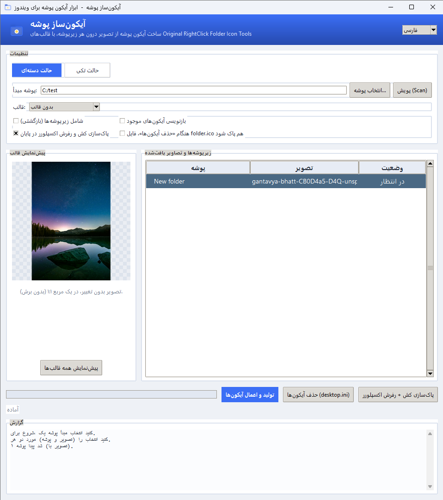
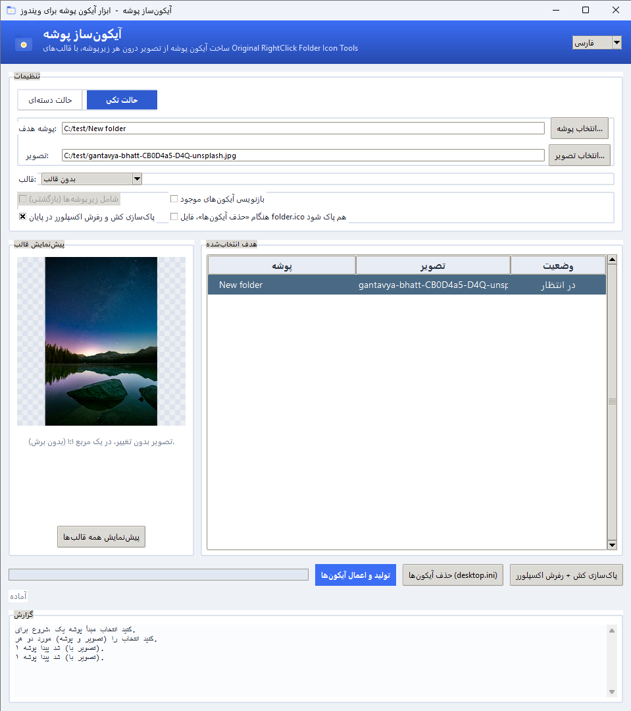
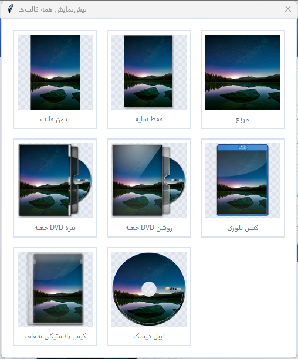

**[English](README.md)** | فارسی

# Folder Icon Maker (آیکون‌ساز پوشه) — ابزار ساخت دسته‌ای آیکون پوشه برای ویندوز


> **یادداشت:** این README — هر دو نسخهٔ فارسی و انگلیسی — با کمک هوش
> مصنوعی نوشته شده است.

**Folder Icon Maker (آیکون‌ساز پوشه)** — تا همین نسخه با نام *RCFI GUI* منتشر
می‌شد؛ **RCFI** مخفف **RightClick Folder Icon** بود، همان پروژهٔ بالادستی که
این رابط گرافیکی بر پایهٔ آن ساخته شده — ابزاری کوچک برای مرتب‌تر شدن
پوشه‌هایتان است: یک پوشهٔ والد انتخاب می‌کنید (مجموعه فیلم/سریال، کتابخانه
بازی‌ها، آرشیو پروژه‌ها و ...) و برنامه برای هر زیرپوشه از روی تصویرِ داخل
خودش یک آیکون مناسب می‌سازد و بلافاصله در اکسپلورر ویندوز اعمال می‌کند —
همه‌چیز با یک کلیک.

همه پوشه‌های ویندوز یک‌شکل‌اند — دیواری از آیکون‌های زرد یکسان. پوشه‌های
بازی‌ها، فیلم‌ها یا سریال‌هایتان را آیکون‌گذاری کنید و در یک نگاه پوشهٔ
موردنظر را پیدا کنید: چشم تصویر را خیلی سریع‌تر از متن تشخیص می‌دهد. هدف
همین است.

این برنامه را خودم با کمک AI نوشته‌ام تا کار مرتب‌کردن فایل‌هایم ساده‌تر شود.
هدف آن یک «رابط گرافیکی کامل» برای
[RightClick Folder Icon Tools](https://github.com/ramdany7/RightClick-Folder-Icon-Tools)
**نیست** — آن پروژه ویژگی‌های بسیار دیگری هم دارد. این برنامه فقط یک کار را
انجام می‌دهد: **ساختن و اعمال آیکون برای تعداد زیادی پوشه، به‌راحتی.**

کد دقیقاً همان دستورات ImageMagick پروژه اصلی را اجرا می‌کند (فقط در لفاف
گرافیکی)، پس خروجی عیناً با پروژه اصلی یکی است و هیچ پنجره `cmd.exe` باز
نمی‌شود.

## فهرست

1. [اسکرین‌شات‌ها](#screenshots)
2. [نحوه کارکرد](#how-it-works)
3. [ویژگی‌ها](#features)
4. [تغییرات v2.3.0](#whats-new)
5. [اجرا (حالت توسعه)](#run)
6. [ساخت فایل اجرایی (exe)](#build)
7. [ساختار فایل‌ها](#file-layout)
8. [Credits](#credits)
9. [لایسنس](#license)

<a id="screenshots"></a>
## اسکرین‌شات‌ها

*برای دیدن اندازه کامل روی هر تصویر کلیک کنید.*

### برنامه — حالت دسته‌ای

<p align="center">
  <a href="docs/app-batch-fa.png"></a>
</p>

پوشه مبدأ را انتخاب و **اسکن** را بزنید — همه زیرپوشه‌ها همراه با تصویری که
داخل هرکدام پیدا شده در فهرست می‌آیند. گزینه‌ها:

- **شامل زیرپوشه‌ها (بازگشتی)** — کل درخت پوشه‌ها پردازش می‌شود، نه فقط سطح اول.
- **بازنویسی آیکون‌های موجود** — حتی اگر پوشه از قبل آیکون داشته باشد
  `folder.ico` دوباره ساخته می‌شود.
- **پاک‌سازی کش و رفرش اکسپلورر در پایان** — تا آیکون‌های جدید فوراً دیده
  شوند (پیش‌فرض روشن).
- **قالب** — ۸ قالب با پیش‌نمایش زنده. عمداً هیچ گزینه‌ی «اندازه‌ای» وجود
  ندارد: هر `folder.ico` همیشه به‌صورت مجموعه‌ی چندردیفه‌ی کامل
  (۱۶ تا ۲۵۶ پیکسل — سقف فرمت ICO) نوشته می‌شود و خودِ ویندوز برای هر
  سطح بزرگ‌نمایی اندازه‌ی درست را برمی‌دارد؛ پس آیکون همیشه به‌وضوحِ
  حداکثریِ فرمت دیده می‌شود.

### حالت تکی

<p align="center">
  <a href="docs/app-single-fa.png"></a>
</p>

برای کارهای تک‌موردی: به **حالت تکی** بروید، یک پوشه و یک تصویر بدهید — همان
پوشه آیکون‌دار می‌شود. همین گزینه‌های قالب اینجا هم اعمال می‌شوند.

### گالری قالب‌ها

<p align="center">
  <a href="docs/templates-fa.png"></a>
</p>

**پیش‌نمایش همه قالب‌ها** تصویر شما را یک‌جا با هر ۸ قالب رندر می‌کند تا قبل
از اعمال، ظاهر درست را انتخاب کنید.

> **نکته:** اگر پنجره «پیش‌نمایش همه قالب‌ها» روی اندازه‌های کوچک نوار اسکرول
> نشان نمی‌دهد، پنجره را بزرگ کنید — این مورد در به‌روزرسانی بعدی بهتر می‌شود.

<a id="how-it-works"></a>
## نحوه کارکرد
1. **انتخاب حالت** — «دسته‌ای» (چند پوشه با هم) یا «تکی» (یک پوشه + یک تصویر).
2. **حالت دسته‌ای:** پوشه مبدأ را انتخاب و «اسکن» را بزنید. برنامه همه
   زیرپوشه‌ها و تصویر داخل هرکدام را فهرست می‌کند. انتخاب تصویر خودکار است:
   نام‌هایی مثل `poster`، `cover`، `folder`، `main`، `artwork` اولویت دارند
   و `logo`، `disc`، `back`، `sample` در اولویت پایین‌اند.
3. **انتخاب قالب** — پیش‌نمایش زنده (زمینه شطرنجی یعنی شفافیت) +
   گالری «پیش‌نمایش همه قالب‌ها».
4. **«ساخت و اعمال آیکون‌ها»** — برای هر پوشه:
   - تصویر با قالب انتخابی به یک `folder.ico` چندردیفه (۱۶ تا ۲۵۶ پیکسل —
     سقف فرمت ICO) تبدیل و **داخل خودِ پوشه** ذخیره می‌شود. برای قالب‌های
     واقعی، ImageMagick **لازم است**؛ بدون آن برنامه اجرا می‌شود اما همه‌ی
     قالب‌ها همان آیکون عمومی جایگزین را می‌سازند (در این حالت هشدار واضحی
     در لاگ نمایش داده می‌شود)؛
   - `desktop.ini` با مسیر **نسبی** `IconResource=folder.ico,0` نوشته
     می‌شود تا پوشه پرتابل بماند؛ و در قالب یونیکد **UTF-16LE** — همان
     قالبی که مایکروسافت برای desktop.ini مستند کرده — تا متن‌های
     بومی‌شدهٔ داخل فایل هرگز خراب نشوند؛ پوشه برچسب ReadOnly و `desktop.ini`
     برچسب Hidden+System می‌گیرد — دقیقاً همان چیزی که ویندوز برای نمایش
     آیکون لازم دارد؛
   - پوشه‌های بدون تصویر — یا با آیکون موجود (مگر اینکه «بازنویسی» زده
     باشید) — رد می‌شوند.
5. **در پایان** (ویندوز) — و فقط **یک بار، بعد از تمام‌شدن کل پردازش** —
   پایگاه‌های کش آیکون/تامبنیل پاک، کش بازسازی و اکسپلورر رفرش می‌شود تا
   آیکون‌های جدید فوراً دیده شوند. (برنامه دیگر بعد از تک‌تک پوشه‌ها خودش
   را با رفرشِ پوسته وقفه نمی‌اندازد — همین کار دسته‌های بزرگ را کند
   می‌کرد.)

   اگر بعد از مدتی بعضی پوشه‌ها هنوز آیکون قدیمی را نشان می‌دهند (پوسته‌ی
   ویندوز گاهی دیر به‌روز می‌شود؛ بستن همه‌ی پنجره‌های اکسپلورر هم کمک
   می‌کند)، دکمه‌ی **«پاک‌سازی کش + رفرش اکسپلورر»** را کنار «ساخت و اعمال
   آیکون‌ها» بزنید: بعد از یک تأیید، کش آیکون پاک و اکسپلورر ری‌استارت
   می‌شود تا همه‌ی آیکون‌های در انتظار فوراً نمایش داده شوند.

<a id="features"></a>
## ویژگی‌ها
- دو حالت کار: **دسته‌ای** (اسکن یک پوشه مبدأ، آیکون‌دار کردن هر زیرپوشه‌ای
  که تصویر دارد) و **تکی** (یک پوشه + یک تصویر).
- رابط گرافیکی مدرن (هدر گرادیانی، کارت‌ها، سوییچر حالت، آیکون پنجره،
  پس‌زمینه شطرنجی در پیش‌نمایش).
- **دو زبانه (فارسی / انگلیسی)** — تشخیص خودکار از زبان سیستم + سوییچ زنده
  بدون ری‌استارت.
- پردازش دسته‌ای با یک کلیک (تعداد تردها متناسب با CPU).
- **دکمهٔ «حذف آیکون‌ها»** — برگرداندنِ یک‌کلیکی: بعد از یک تأیید صریح،
  سیم‌کشی آیکون (`desktop.ini`) از همهٔ پوشه‌های فهرست‌شده برداشته می‌شود و
  پوشه‌ها به شکل عادی ویندوز برمی‌گردند. تنظیماتی که برنامه در
  `desktop.ini` ننوشته حفظ می‌شوند؛ فایل ساخته‌شدهٔ `folder.ico` هم سر جایش
  می‌ماند مگر اینکه گزینهٔ «فایل folder.ico هم پاک شود» را بزنید.
- **دکمه‌ی «پاک‌سازی کش + رفرش اکسپلورر»** — هر وقت خواستید با یک کلیک:
  کش آیکون/تامبنیل پاک و — بعد از یک تأیید — اکسپلورر ری‌استارت می‌شود تا
  پوشه‌هایی که هنوز آیکون قدیمی را نشان می‌دهند فوراً تازه‌سازی شوند.
- ۸ قالب وفادار به پروژه اصلی: `(none)`، `(Shadow Only)`، `Square`،
  `DVDBox Dark`، `DVDBox Light`، `DVDCase Bluray`،
  `DVDCase Transparent Plastic`، `DiscArt`. (لایه‌های متادیتای NFO مثل
  امتیاز/ژانر IMDb عمداً پورت نشده‌اند.)
- **فرمت‌های تصویری پشتیبانی‌شده**: JPG/JPEG/JPE/JFIF، PNG، BMP/DIB، GIF،
  WebP، TIFF، TGA، AVIF، HEIC/HEIF و SVG (سه فرمت آخر به قابلیت‌های
  ImageMagick نصب‌شده وابسته‌اند).
- تعویض آیکون پوشه‌هایِ ازقبل-آیکون‌دار همیشه کار می‌کند: اول `desktop.ini`
  موجود خوانده و با محتوای قبلی ادغام می‌شود و بعد به‌صورت اتمیک جایگزین
  می‌شود — خصیصه‌ها فقط درست قبل از تعویض دست می‌خورند و در صورت خطا
  برمی‌گردند.
- آیکون پوشه کاملاً پرتابل است: `folder.ico` داخل خود پوشه ذخیره می‌شود و
  فقط با نام به آن ارجاع می‌شود.
- بدون ImageMagick برنامه اجرا می‌شود، اما همه‌ی قالب‌ها همان آیکون عمومی
  جایگزین را می‌سازند — هشداری در لاگ نمایش داده می‌شود. برای قالب‌های
  واقعی، ImageMagick لازم است.

<a id="whats-new"></a>
## تغییرات v2.3.0
- **برنامه نام جدید و گویاتری گرفت: Folder Icon Maker (آیکون‌ساز پوشه)** —
  پیش‌تر *RCFI GUI*؛ نام قبلی مخفف پروژهٔ بالادستی بود، نه توصیف کار خود برنامه.
- دکمهٔ جدید **«حذف آیکون‌ها»** (با تأیید صریح)، نوشتن `desktop.ini` با
  **UTF-16LE**، اصلاح اعتبار هنرمندان به‌تفکیک قالب، و جمعی از استحکام‌بخشی‌ها
  از بازبینی‌های کد.
- **تاریخچهٔ کامل تغییرات:** [CHANGELOG.md](CHANGELOG.md) — همهٔ نسخه‌ها،
  به انگلیسی و فارسی.

<a id="run"></a>
## اجرا (حالت توسعه)
نیاز به Python 3.10+ و ImageMagick (نصب شده و در PATH):
```
pip install pillow
python main.py
```

رابط کاربری **دو زبانه (فارسی / انگلیسی)** است؛ زبان از محیط سیستم‌عامل
تشخیص داده می‌شود و از کادر ترکیبی گوشه‌ی هدر برنامه، به‌صورت زنده (بدون
ری‌استارت) قابل تغییر است. انتخاب کاربر در `~/.folder_icon_maker.json`
ذخیره می‌شود.

<a id="build"></a>
## ساخت فایل اجرایی (exe)
PyInstaller نمی‌تواند cross-compile کند؛ بنابراین فایل exe باید روی
**ویندوز** ساخته شود. کافی است یک بار اجرا شود:
```
pip install pyinstaller
build.bat
```
خروجی در `dist\FolderIconMaker.exe` قرار می‌گیرد (بدون پنجره کنسول، آیکون دار).

> **این برنامه فقط برای ویندوز است.** آیکون پوشه یک قابلیتِ پوستهٔ ویندوز
> است (`desktop.ini` + اکسپلورر)؛ لینوکس و macOS ساختار کاملاً متفاوت و
> ناسازگاری دارند و این برنامه در آن‌ها هیچ کارکردی ندارد. فایل exe
> واقعی فقط روی ویندوز و با `build.bat` / `build_dir.bat` ساخته می‌شود.

> **تفاوت `FolderIconMaker.bat` و `build.bat`:** فایل `FolderIconMaker.bat`
> یک لانچر توسعه‌ای است که `python main.py` اجرا می‌کند و **نیاز به نصب
> Python دارد** — آن را با فایل اجرایی اشتباه نگیرید. فایل exe واقعی فقط
> با `build.bat` ساخته می‌شود.

> **اگر exe به‌صورت متناوب ارور می‌دهد:** فایل‌های onefile هر بار در
> `%TEMP%\_MEIxxxx` استخراج می‌شوند و گاهی آنتی‌ویروس یا پاک‌ساز تِمپ جلوی
> اجرا را می‌گیرد. در این صورت از نسخه پایدارتر استفاده کنید:
> ```
> build_dir.bat
> ```
> خروجی یک **پوشه** (`dist\FolderIconMaker\`) می‌دهد که خودش پرتابل است —
> کافیست کل پوشه را کپی/زیپ کنید.

### نیازمندی‌ها و پرتابل بودن
- برنامه برای قالب‌های واقعی به **ImageMagick** نیاز دارد، به یکی از این
  دو روش: یا ImageMagick روی سیستم **نصب** باشد (خودکار پیدا می‌شود)، یا
  نسخهٔ **پرتابل** آن در مسیر `rcfi_assets/resources/` کنار برنامه باشد —
  در نسخهٔ پوشه‌ای (onedir) کافی است آن را داخل همان پوشه بیندازید. اگر
  نسخهٔ پرتابل **قبل از ساخت** آنجا باشد، `build.bat` آن را داخل exe
  بسته‌بندی می‌کند تا نسخهٔ نهایی اصلاً به نصب ImageMagick نیاز نداشته
  باشد. ImageMagick پرتابل فقط یک فایل نیست: `magick.exe` را **همراه با
  پوشهٔ فایل‌های مورد نیازش که کنارش قرار دارد** (config، modules و ...)
  نگه دارید — ImageMagick آن‌ها را نسبت به محل خود exe پیدا می‌کند، پس هر
  دو عیناً همان‌طور که هستند کپی می‌شوند. محتوای `rcfi_assets/resources/`
  در گیت ذخیره **نمی‌شود**.
  - `locate_imagick` هر باینری را قبل از استفاده با `-version` تست می‌کند،
    پس باینری که خراب یا توسط آنتی‌ویروس مسدود شده باشد باعث کرش نمی‌شود.
- اگر exe ارور داد، لاگ خطا اینجا ثبت می‌شود و قابل بررسی است:
  `%TEMP%\FolderIconMaker\error.log`

<a id="file-layout"></a>
## ساختار فایل‌ها
```
main.py            رابط گرافیکی (Tkinter)
i18n.py            متن‌های دو زبانه (فارسی / انگلیسی) + تشخیص و ذخیره زبان
icon_engine.py     پیدا کردن تصویر درون پوشه + ساخت folder.ico
rcfi_templates.py  پورت دقیق قالب‌های ImageMagick پروژه اصلی
windows_folder.py  اعمال آیکون روی پوشه (ویندوز)
templates_lib.py   فال‌بک خالص پایتون (بدون ImageMagick)
rcfi_assets/       تصاویر قالب‌ها
assets/            icon.ico و sample.png
docs/              اسکرین‌شات‌ها
build.bat / build_dir.bat  اسکریپت‌های ساخت ویندوز
build.sh           ابزار اجرا/آزمایش «کد» روی سیستم‌های غیرویندوزی
                   (ساخت برنامه نیست — برنامه فقط ویندوزی است)
FolderIconMaker.bat  لانچر توسعه‌ای: اجرای main.py با پایتون نصب‌شده
CHANGELOG.md       تاریخچهٔ کامل تغییرات (انگلیسی + فارسی)
```

<a id="credits"></a>
## Credits
قالب‌ها، تصاویر قالب و دستورات ImageMagick بر پایه‌ی پروژه
[RightClick Folder Icon Tools](https://github.com/ramdany7/RightClick-Folder-Icon-Tools)
اثر [Ramdany](https://github.com/ramdany7) (MIT License) است — زیرمجموعه‌ای
از قالب‌های آن پروژه به‌علاوه‌ی قالب «Square» که متعلق به همین پروژه است.

اسکریپت‌های قالبِ خودِ پروژهٔ بالادستی، هنرمند هر قالب را مشخص می‌کنند؛
طبق بررسی مستقیم همان اسکریپت‌ها (سرصفحهٔ `templates/*.bat`)، قالب‌های
پورت‌شده در این برنامه از این هنرمندان‌اند:

- [em1l](https://www.deviantart.com/em1l) — `DVDBox Dark`، `DVDBox Light`،
  `DVDCase Transparent Plastic`
- [saikuro](https://www.deviantart.com/saikuro) — `DVDCase Bluray`

`(none)` و `(Shadow Only)` ترکیب‌های سادهٔ ImageMagick‌اند و PSD مستقل
ندارند. `DiscArt` از قالب DiscArtِ بالادستی پورت شده و اسکریپت آن هنرمند
مشخصی را نام نمی‌برد — برای آن، اعتبار جمعیِ README بالادستی برای منابع PSD
([em1l](https://www.deviantart.com/em1l)،
[saikuro](https://www.deviantart.com/saikuro)،
[mauricioestrella](https://www.deviantart.com/mauricioestrella)،
[90scomics.com](http://www.90scomics.com) و
[Jonathan Brimer](https://beoriginal.com/blog/free-folder-icon-photoshop-template))
اعمال می‌شود.
Runtime از [ImageMagick](https://imagemagick.org) استفاده می‌کند
(ImageMagick License).

پوستر نمونه‌ی (`assets/sample.png`) که در پیش‌نمایش‌ها دیده می‌شود کامل با
کد ساخته شده است (خودِ برنامه هر وقت فایل نباشد، همان را از نو
می‌سازد)؛ هیچ محتوای شخص ثالثی در آن نیست و با همان مجوز MIT همراه پروژه
منتشر می‌شود.

اعلان‌ها و متن کامل لایسنس‌های شخص ثالث: [THIRD_PARTY_LICENSES.txt](THIRD_PARTY_LICENSES.txt).
Blu-ray Disc و DTS-HD علامت‌های تجاری صاحبان آن‌ها هستند — این پروژه
هیچ وابستگی یا تأییدی از آن‌ها ندارد.

<a id="license"></a>
## لایسنس
این پروژه تحت لایسنس MIT منتشر شده است — [LICENSE](LICENSE) متن خالص MIT با
هر دو خط کپی‌رایت (این پروژه و پروژه بالادستی RightClick Folder Icon Tools)
است. متن کامل لایسنس‌های شخص ثالث (RightClick Folder Icon Tools،
ImageMagick، Pillow، Python و Tcl/Tk) و نکته‌ی علامت‌های تجاری در
[THIRD_PARTY_LICENSES.txt](THIRD_PARTY_LICENSES.txt) جمع شده است.
