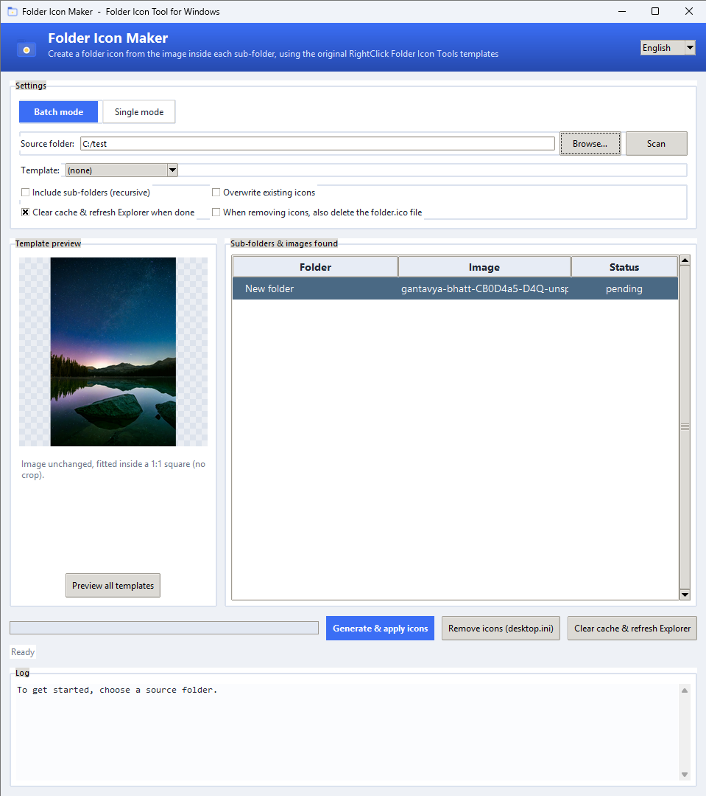
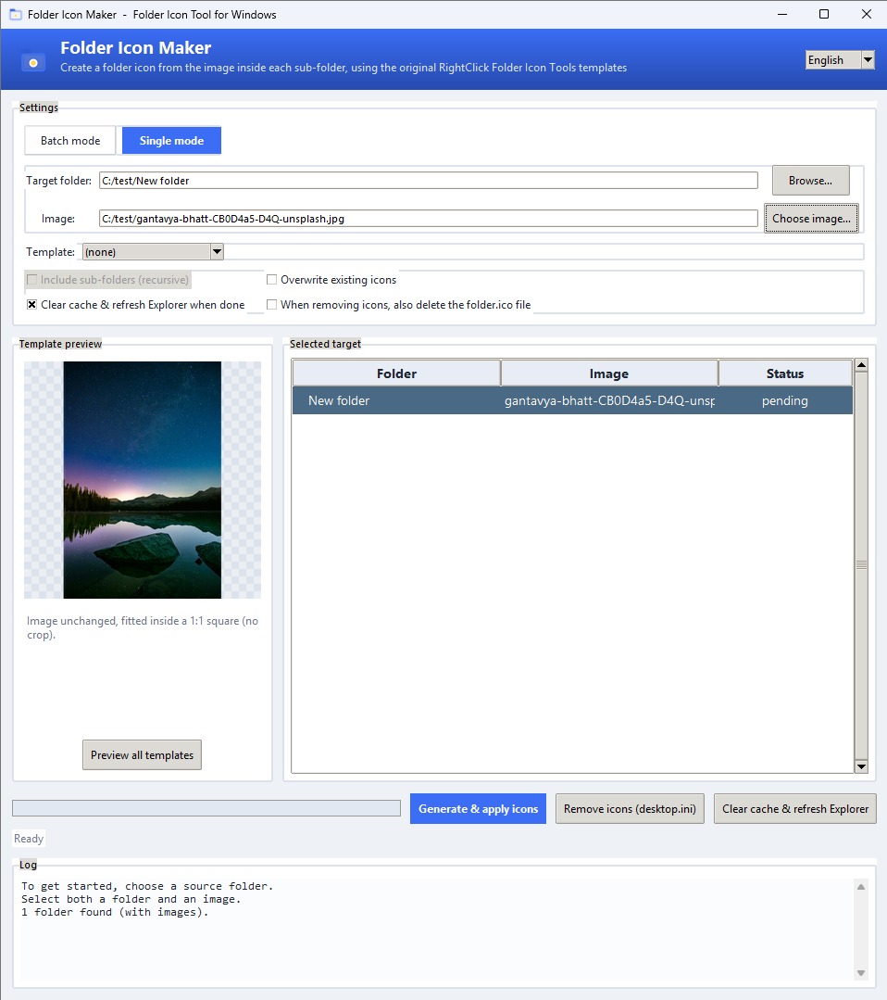
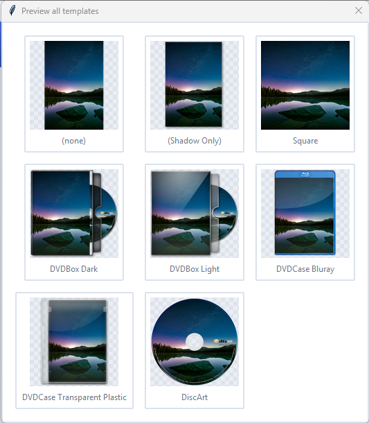

**English** | [فارسی](README.fa.md)

# Folder Icon Maker — Batch Folder Icon Tool for Windows


> **Note:** this README — English and Persian — was written with the help
> of AI.

**Folder Icon Maker** — until now released as *RCFI GUI*; **RCFI** was short
for **RightClick Folder Icon**, the upstream project this GUI is based on —
is a small tool for keeping your folders
organized: you pick a parent folder (a movie/series collection, a games
library, a projects archive, ...) and it builds a proper icon for every
sub-folder from the image inside it, then applies it right away in Windows
Explorer — all in one click.

Every Windows folder looks the same — a wall of identical yellow icons.
Icon your Games, Movies or Series folders and you spot the right one at a
glance: the eye recognizes images far faster than text. That is exactly
what this tool is for.

I wrote this app myself, with the help of AI, to make my own file-organizing
work easier. It is **not** a full GUI for
[RightClick Folder Icon Tools](https://github.com/ramdany7/RightClick-Folder-Icon-Tools)
— that project has many more features. This one focuses on a single job:
**creating and applying icons for a large number of folders, easily.**

The code runs exactly the same ImageMagick commands as the original project
(just wrapped in a GUI), so the output is identical to it and no `cmd.exe`
window ever pops up.

## Contents

1. [Screenshots](#screenshots)
2. [How it works](#how-it-works)
3. [Features](#features)
4. [What's new in v2.3.0](#whats-new-in-v230)
5. [Run (development)](#run-development)
6. [Building the executable (exe)](#building-the-executable-exe)
7. [File layout](#file-layout)
8. [Credits](#credits)
9. [License](#license)

## Screenshots

*Click any image to view it full size.*

### The app — batch mode

<p align="center">
  <a href="docs/app-batch-en.png"></a>
</p>

Pick the source folder, press **Scan** — every sub-folder appears in the
list together with the image found inside it. The options:

- **Include sub-folders (recursive)** — process the whole folder tree, not
  just the first level.
- **Overwrite existing icons** — rebuild `folder.ico` even if the folder
  already has one.
- **Clear cache & refresh Explorer when done** — so the new icons show up
  immediately (on by default).
- **Template** — 8 templates with live preview. There is deliberately no
  size option: every `folder.ico` is always written as a full
  multi-resolution set (16–256 px, the ICO format maximum) and Windows
  picks the right size for every zoom level itself, so the icon is always
  as sharp as the format allows.

### Single mode

<p align="center">
  <a href="docs/app-single-en.png"></a>
</p>

For one-off jobs: switch to **Single mode**, give it one folder and one
image — that folder gets the icon. The same template options apply.

### Template gallery

<p align="center">
  <a href="docs/templates-en.png"></a>
</p>

**Preview all templates** renders your image through all 8 templates in one
view, so you can pick the right look before applying anything.

> **Tip:** if the dialog shows no scrollbar on a small window, maximize the
> window — this will be improved in the next update.

## How it works
1. **Choose a mode** — *Batch* (many folders at once) or *Single* (one
   folder + one image).
2. **Batch:** pick the source folder and press *Scan*. The app lists every
   sub-folder and the image found inside it. The image is picked
   automatically: names like `poster`, `cover`, `folder`, `main`, `artwork`
   are preferred; `logo`, `disc`, `back`, `sample` are avoided.
3. **Pick a template** — live preview (the checkerboard background
   shows transparency), plus a "preview all templates" gallery.
4. **Generate & apply icons** — for every folder:
   - the image is rendered through the selected template into a
     multi-resolution `folder.ico` (16–256 px — the ICO format maximum)
     saved **inside** that folder. ImageMagick is **required** for the
     faithful templates; without it the app still runs, but every template
     then produces the same generic fallback icon (the log shows a clear
     warning when that happens);
   - `desktop.ini` is written with a **relative** `IconResource=folder.ico,0`
     so the folder stays portable, in the Unicode (**UTF-16LE**) format
     Windows documents for it — so localized text in the file can never
     turn into mojibake; the folder gets ReadOnly and `desktop.ini`
     gets Hidden+System — exactly what Windows requires to show the icon;
   - folders without an image — or with an existing icon, unless *Overwrite*
     is checked — are skipped.
5. **When finished** (Windows) — and only once, after the whole batch —
   the icon/thumbnail cache databases are cleared, the cache is rebuilt and
   Explorer is refreshed, so the new icons appear immediately. (The app does
   **not** interrupt itself with a shell refresh after every single folder
   any more — that made large batches slow.)

   If some folders still show the old icon after a while (the Windows shell
   sometimes lags behind; closing all Explorer windows helps too), press the
   **Clear cache & refresh Explorer** button next to *Generate*: after a
   confirmation it clears the icon cache and restarts Explorer, so every
   pending icon shows up right away.

## Features
- Two working modes: **Batch** (scan a source folder, icon every sub-folder
  that contains an image) and **Single** (one folder + one image).
- Modern GUI (gradient header, cards, mode switcher, window icon,
  checkerboard background behind previews).
- **Bilingual (Persian / English)** — auto-detected from the OS language +
  live switching without restart.
- One-click batch processing (thread count scales with CPU).
- **"Remove icons" button** — the one-click undo: after an explicit
  confirmation it takes the icon wiring (`desktop.ini`) back out of every
  scanned folder and returns them to the normal Windows look. Settings in
  `desktop.ini` that the app did not write survive; the generated
  `folder.ico` is kept unless you tick "also delete the folder.ico file".
- **"Clear cache & refresh Explorer" button** — one click, any time: clears
  the icon/thumbnail cache and restarts Explorer (after a confirmation) so
  folders that still show the old icon are repainted immediately.
- 8 templates faithful to the original project: `(none)`, `(Shadow Only)`,
  `Square`, `DVDBox Dark`, `DVDBox Light`, `DVDCase Bluray`,
  `DVDCase Transparent Plastic`, `DiscArt`. (NFO metadata layers such as
  IMDb rating/genre were intentionally not ported.)
- **Supported image formats**: JPG/JPEG/JPE/JFIF, PNG, BMP/DIB, GIF, WebP,
  TIFF, TGA, AVIF, HEIC/HEIF and SVG (the last three depend on the
  capabilities of the installed ImageMagick).
- Re-iconing already-iconed folders always works: existing `desktop.ini`
  attributes are stripped before rewriting.
- Portable folder icons: `folder.ico` lives inside the folder and is
  referenced by name only.
- Without ImageMagick the app still runs, but every template then produces
  the same generic fallback icon — a warning is shown in the log. ImageMagick
  is required for the faithful templates.

## What's new in v2.3.0
- **The app has a new, self-explanatory name: Folder Icon Maker** (formerly
  *RCFI GUI* — the old name abbreviated the upstream project, not the app).
- A new **"Remove icons"** button (with an explicit confirmation),
  `desktop.ini` now written as **UTF-16LE**, per-template artist credits
  corrected, and a batch of hardening fixes from the code reviews.
- **Full version history:** [CHANGELOG.md](CHANGELOG.md) — every release,
  in English and Persian.

## Run (development)
Requires Python 3.10+ and ImageMagick (installed and on PATH):
```
pip install pillow
python main.py
```

The UI is **bilingual (Persian / English)**; the language is detected from
the OS environment and can be switched live (no restart) from the combo box
in the header. The choice is stored in `~/.folder_icon_maker.json`.

## Building the executable (exe)
PyInstaller cannot cross-compile, so the exe must be built **on Windows**.
Just run once:
```
pip install pyinstaller
build.bat
```
The output lands in `dist\FolderIconMaker.exe` (no console window, with icon).

> **Folder Icon Maker is Windows-only.** Folder icons are a Windows shell
> feature (`desktop.ini` + Explorer); Linux and macOS have a completely
> different and incompatible mechanism, so this app has no function there.
> The real exe can only be built on Windows with `build.bat` /
> `build_dir.bat`.

> **Difference between `FolderIconMaker.bat` and `build.bat`:**
> `FolderIconMaker.bat` is a development launcher that runs `python main.py`
> and **requires Python to be installed** — don't confuse it with the
> executable. The real exe is only built by `build.bat`.

> **If the exe reports errors intermittently:** onefile builds are extracted
> on every run into `%TEMP%\_MEIxxxx` and sometimes antivirus or temp-cleaner
> tools block execution. In that case use the more stable variant:
> ```
> build_dir.bat
> ```
> It outputs a **folder** (`dist\FolderIconMaker\`) which is itself
> portable — just copy/zip the whole folder.

### Requirements & portability
- The app needs **ImageMagick** for the faithful templates, in one of two
  ways: either ImageMagick is **installed** on the system (picked up
  automatically), or a **portable** copy sits in `rcfi_assets/resources/`
  next to the app — in the onedir (folder) build you can simply drop it
  into that folder yourself. If the portable copy is placed there
  **before building**, `build.bat` packs it into the exe, so the finished
  app needs no ImageMagick installation at all. A portable ImageMagick is
  more than one file: keep `magick.exe` **together with the folder of
  support files that ships next to it** (config, modules, ...) —
  ImageMagick resolves those relative to the exe, so both are copied
  as-is. Nothing in `rcfi_assets/resources/` is stored in git.
  - `locate_imagick` probes every binary with `-version` before using it, so
    a broken or AV-blocked binary never crashes the app.
- If the exe errors out, the log is written here for inspection:
  `%TEMP%\FolderIconMaker\error.log`

## File layout
```
main.py            GUI (Tkinter)
i18n.py            bilingual strings (Persian / English) + language detection & persistence
icon_engine.py     find the image inside a folder + build folder.ico
rcfi_templates.py  faithful port of the original project's ImageMagick templates
windows_folder.py  apply the icon to folders (Windows)
templates_lib.py   pure-Python fallback (no ImageMagick)
rcfi_assets/       template images
assets/            icon.ico and sample.png
docs/              screenshots
build.bat / build_dir.bat  Windows build scripts
build.sh           dev/test helper to run the code on non-Windows systems
                   (NOT an app build — the app is Windows-only)
FolderIconMaker.bat  dev launcher: runs main.py with the installed Python
CHANGELOG.md       full version history (English + Persian)
```

## Credits
The icon templates, the template images and their ImageMagick commands are
based on [RightClick Folder Icon Tools](https://github.com/ramdany7/RightClick-Folder-Icon-Tools)
by [Ramdany](https://github.com/ramdany7) (MIT License) — a subset of its
templates, plus this project's own `Square` template.

The upstream project's own template scripts credit the artwork per
template; as verified directly from those scripts (`templates/*.bat`
headers), the templates ported to this project come from:

- [em1l](https://www.deviantart.com/em1l) — `DVDBox Dark`, `DVDBox Light`,
  `DVDCase Transparent Plastic`
- [saikuro](https://www.deviantart.com/saikuro) — `DVDCase Bluray`

`(none)` and `(Shadow Only)` are plain ImageMagick compositions with no PSD
artwork of their own. `DiscArt` is ported from upstream's DiscArt template,
whose script names no single artist — for it, the upstream README's
collective credit for its PSD sources
([em1l](https://www.deviantart.com/em1l),
[saikuro](https://www.deviantart.com/saikuro),
[mauricioestrella](https://www.deviantart.com/mauricioestrella),
[90scomics.com](http://www.90scomics.com) and
[Jonathan Brimer](https://beoriginal.com/blog/free-folder-icon-photoshop-template))
applies. Runtime
uses [ImageMagick](https://imagemagick.org) (ImageMagick License).

The sample poster (`assets/sample.png`) shown in the previews is generated
entirely by code — the app itself recreates it whenever the file is
missing; it contains no third-party material and ships with the project
under the same MIT license.

Full third-party notices and license texts: [THIRD_PARTY_LICENSES.txt](THIRD_PARTY_LICENSES.txt).
Blu-ray Disc and DTS-HD are trademarks of their respective owners — this
project is not affiliated with or endorsed by them.

## License
Released under the MIT License — [LICENSE](LICENSE) is a pure MIT text with
both copyright lines (this project and the upstream RightClick Folder Icon
Tools). The full third-party license texts (RightClick Folder Icon Tools,
ImageMagick, Pillow, Python, Tcl/Tk) and the trademark notice are collected
in [THIRD_PARTY_LICENSES.txt](THIRD_PARTY_LICENSES.txt).
